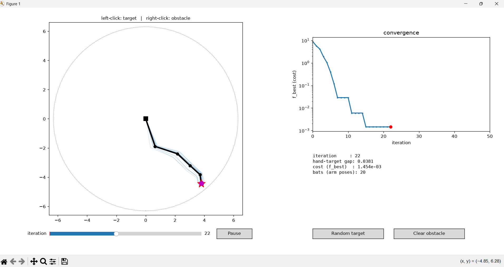

# Advanced AI — Bat Algorithm & Robotic Arm Simulation

An interactive Python implementation of the **Bat Algorithm (BA)**, demonstrated through a robotic arm inverse kinematics simulation.

The project visualizes how a population-based optimization algorithm searches for the optimal joint angles that allow a multi-link robotic arm to reach a target position while avoiding obstacles.

<p align="center">
  <strong>Nature-Inspired Optimization · Inverse Kinematics · Interactive Visualization</strong>
</p>

---

## Overview

The **Bat Algorithm** is a nature-inspired metaheuristic optimization algorithm based on the echolocation behavior of microbats.

In this project, the algorithm is applied to a robotic arm inverse kinematics problem:

- Each bat represents a possible configuration of the robotic arm.
- Each configuration is represented by a vector of joint angles.
- The objective function evaluates how close the robot's end effector (hand) is to the target.
- An additional penalty discourages the arm from intersecting obstacles.
- The algorithm iteratively improves the candidate configurations until it reaches a better solution or satisfies the stopping condition.

The simulation provides a visual representation of the optimization process, making it easier to understand how the population evolves over successive iterations.

## Example of the GUI:


## Features

- **Bat Algorithm implementation:** A customizable implementation of the optimization algorithm.
- **Interactive robotic arm:** A five-joint, multi-link robotic arm visualization.
- **Inverse kinematics optimization:** Finds joint configurations that move the robot's hand toward a selected target.
- **Real-time visualization:** Observe the optimization process as it progresses.
- **Smooth arm animation:** Interpolates between successive joint configurations.
- **Obstacle avoidance:** Place obstacles in the workspace and penalize configurations that intersect them.
- **Interactive target selection:** Move the target using the mouse.
- **Random target generation:** Generate new target positions to experiment with different configurations.
- **Convergence visualization:** Monitor the best objective function value throughout the optimization process.
- **Optimization controls:** Play, pause, and inspect previously calculated iterations.

## Project Structure

```text
Advanced_AI/
│
├── algo.py             # Bat Algorithm implementation
│
├── bat_arm_gui.py      # Robotic arm simulation and interactive GUI
│
├── main.py             # Application entry point
│
├── requirements.txt    # Python dependencies
│
└── README.md           # Project documentation
```

## Getting Started

### 1. Clone the repository

```bash
git clone https://github.com/ahmedmick/Advanced_AI.git
```

### 2. Navigate to the project directory

```bash
cd Advanced_AI
```

### 3. Create a virtual environment (recommended)

```bash
python -m venv .venv
```

Activate it:

**Windows:**
```bash
.venv\Scripts\activate
```

**Linux / macOS:**
```bash
source .venv/bin/activate
```

### 4. Install dependencies

```bash
pip install -r requirements.txt
```

### 5. Run the simulation

```bash
python main.py
```

## How to Use the Simulation

The simulation provides an interactive workspace where you can experiment with the robotic arm and observe the optimization process.

| Interaction | Action |
|---|---|
| Left mouse click | Select a new target position |
| Right mouse click | Place an obstacle |
| Play / Pause button | Control the optimization animation |
| Iteration slider | Inspect calculated optimization iterations |
| Random Target button | Generate a random target position |
| Clear Obstacle button | Remove the current obstacle |

When a new target is selected, the algorithm starts a new optimization run using the previous arm configuration as its starting point when available.

## Optimization Problem

### 1. Decision Variables

The robotic arm has five joints. Its configuration is represented by:

\[
\boldsymbol{\theta} =
[\theta_1,\theta_2,\theta_3,\theta_4,\theta_5]
\]

Each element represents a joint angle.

### 2. Forward Kinematics

The position of each joint is calculated using the cumulative joint angles and the corresponding link lengths.

The end effector position is obtained through forward kinematics.

### 3. Objective Function

The optimization objective minimizes the squared Euclidean distance between the hand and the target:

\[
f(\boldsymbol{\theta}) =
\left\|
\mathbf{p}_{hand}(\boldsymbol{\theta})
-
\mathbf{p}_{target}
\right\|^2
+
P(\boldsymbol{\theta})
\]

Where:

- \(\mathbf{p}_{hand}\) is the end effector position.
- \(\mathbf{p}_{target}\) is the desired target position.
- \(P(\boldsymbol{\theta})\) is the obstacle penalty.

The obstacle penalty increases when any robotic arm segment enters an obstacle.

### 4. Bat Algorithm

The algorithm searches for better joint configurations by updating:

- Bat positions.
- Bat velocities.
- Frequencies.
- Loudness.
- Pulse emission rates.

Each iteration generates and evaluates candidate solutions, updates the global best solution, and improves the population.

## Technologies Used

- **Python** — Main programming language.
- **NumPy** — Numerical operations and population-based calculations.
- **Matplotlib** — Interactive visualization, animation, and optimization plots.

## Dependencies

The project dependencies are listed in `requirements.txt`.

Install them using:

```bash
pip install -r requirements.txt
```

## Future Improvements

Potential extensions include:

- Experimenting with different Bat Algorithm variants.
- Comparing the Bat Algorithm with other nature-inspired optimization algorithms.
- Improving obstacle avoidance and collision handling.
- Adding more robotic joints and configurable link lengths.
- Introducing alternative objective functions.
- Comparing convergence speed and solution quality across different optimization methods.

## References

- Yang, X.-S. (2010). *A New Metaheuristic Bat-Inspired Algorithm*. In Nature Inspired Cooperative Strategies for Optimization (NICSO 2010).
- Yang, X.-S. (2014). *Nature-Inspired Optimization Algorithms*. Elsevier.

## Author

**Ahmed Mohamed Fathy**

GitHub: [@ahmedmick](https://github.com/ahmedmick)

Project Repository: [Advanced_AI](https://github.com/ahmedmick/Advanced_AI)

---

If you find this project interesting, consider giving the repository a ⭐.
